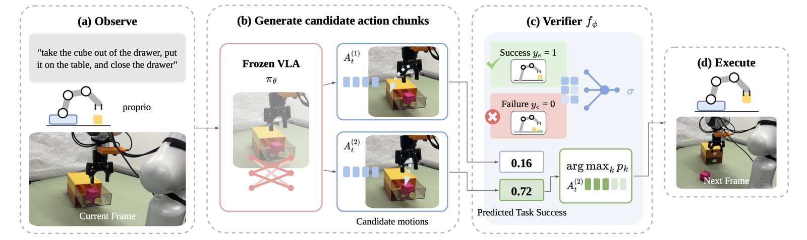
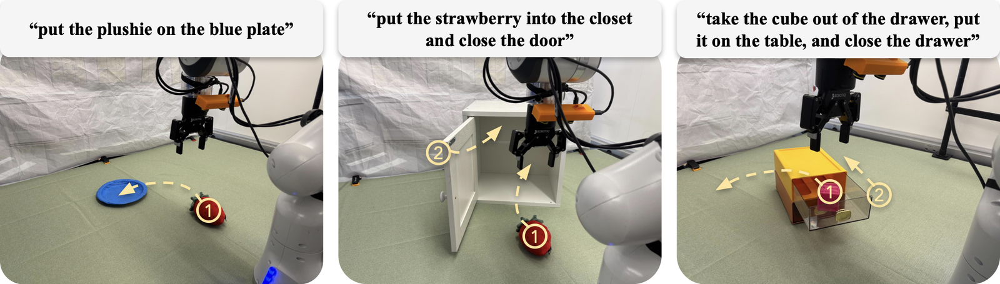

# Learning Low-Latency Action Verification for Frozen Vision-Language-Action Models

Wen-Han Hsieh<sup>1</sup>, Ken Jiankun Zheng<sup>1</sup>, Chia-Chien Chen<sup>2</sup>, David Chan<sup>1</sup>, Trevor Darrell<sup>1</sup><br>
<sup>1</sup>UC Berkeley, <sup>2</sup>National Tsing Hua University

[Project Page](https://wen-hanhsieh.github.io/hdh/)


This repository contains the real-robot code of **HDH** on a Franka Panda with the [DROID](https://github.com/droid-dataset/droid) setup. For the LIBERO simulation experiments, see [hdh_sim](https://github.com/Wen-HanHsieh/hdh_sim).

## Introduction

HDH improves a frozen VLA by choosing which of its own sampled actions to execute. The method has three stages.
1. Deploy the frozen policy and record autonomous rollouts with their terminal success or failure.
2. Train a compact verifier that assigns each action chunk a predicted task-success score. Every query of an episode is labeled with that episode's outcome.
3. At each query, sample K=2 action chunks from the frozen VLA and execute the first H=8 actions of the highest-scoring one.



The verifier runs on the policy server next to π0.5. It reads the policy's own SigLIP prefix tokens, the joint and gripper state, the candidate's executed prefix, and a GRU summary of the three preceding queries.



## Installation

**GPU server.** Install [openpi](https://github.com/Physical-Intelligence/openpi) and register our fine-tuning config.

```bash
git clone https://github.com/Wen-HanHsieh/hdh_real.git && cd hdh_real
export PYTHONPATH=$PWD
git clone --recurse-submodules https://github.com/Physical-Intelligence/openpi.git
(cd openpi && GIT_LFS_SKIP_SMUDGE=1 uv sync)
python scripts/add_config.py --openpi openpi
```

**Robot workstation.** Install the [DROID](https://droid-dataset.github.io/droid/) robot stack, then copy `robot/` to the workstation.

```bash
pip install tyro pillow "openpi-client @ git+https://github.com/Physical-Intelligence/openpi.git#subdirectory=packages/openpi-client"
```

## Step 1: Fine-tune the Policy

We fine-tune π0.5-DROID with LoRA on 80 teleoperated demonstrations across four tasks for 5,000 steps. Convert your demonstrations to a LeRobot dataset named `hdh/droid`, then train.

```bash
cd openpi && uv run scripts/train.py pi05_droid_hdh --exp-name hdh
```

The policy stays frozen from here on. Set `POLICY=openpi/checkpoints/pi05_droid_hdh/hdh/4999`.

## Step 2: Collect Rollouts

Serve the frozen policy and record rollouts with the operator's success or failure label.

```bash
# GPU server
openpi/.venv/bin/python scripts/serve.py --config pi05_droid_hdh --checkpoint $POLICY
# robot workstation
python robot/main.py --host <server-ip> --record_dir /data/hdh_rollouts/drawer
```

## Step 3: Train the Verifier

Extract the policy's prefix tokens for every executed query, then train one verifier per task. Twenty percent of episodes are held out for validation.

```bash
for t in plate drawer closet; do
  openpi/.venv/bin/python scripts/build_dataset.py --rollouts /data/hdh_rollouts/$t \
      --config pi05_droid_hdh --checkpoint $POLICY --out data/$t.npz
  python scripts/train.py --data data/$t.npz --out checkpoints/$t.pt --history
done
```

## Step 4: Deploy

Serve with the verifiers to sample two candidates per query and execute the selected one. Each instruction is routed to the verifier whose name it contains: `plate`, `drawer` or `closet`.

```bash
# GPU server
openpi/.venv/bin/python scripts/serve.py --config pi05_droid_hdh --checkpoint $POLICY --selector checkpoints
# robot workstation
python robot/main.py --host <server-ip> --noise_seed 1000
```

With `--noise_seed`, the first candidate at every query equals the baseline's sample, so use the same value for both. `--shared_prefix` batches the two candidates through one prefix forward pass.

## Results

Success rate over 50 trials per task and method.

| Task | Baseline | HDH (Ours) |
| --- | :-: | :-: |
| Plushie onto plate | 64% | **94%** |
| Cube out of drawer; close drawer | 38% | **52%** |
| Strawberry into closet; close door | 32% | **56%** |
| Average | 44.7% | **67.3%** |

## Acknowledgement

This repository builds on [openpi](https://github.com/Physical-Intelligence/openpi) and [DROID](https://github.com/droid-dataset/droid).

## Citation

```bibtex
@article{hsieh2026hdh,
  title   = {Learning Low-Latency Action Verification for Frozen Vision-Language-Action Models},
  author  = {Hsieh, Wen-Han and Zheng, Ken Jiankun and Chen, Chia-Chien and Chan, David and Darrell, Trevor},
  journal = {arXiv preprint},
  year    = {2026}
}
```
